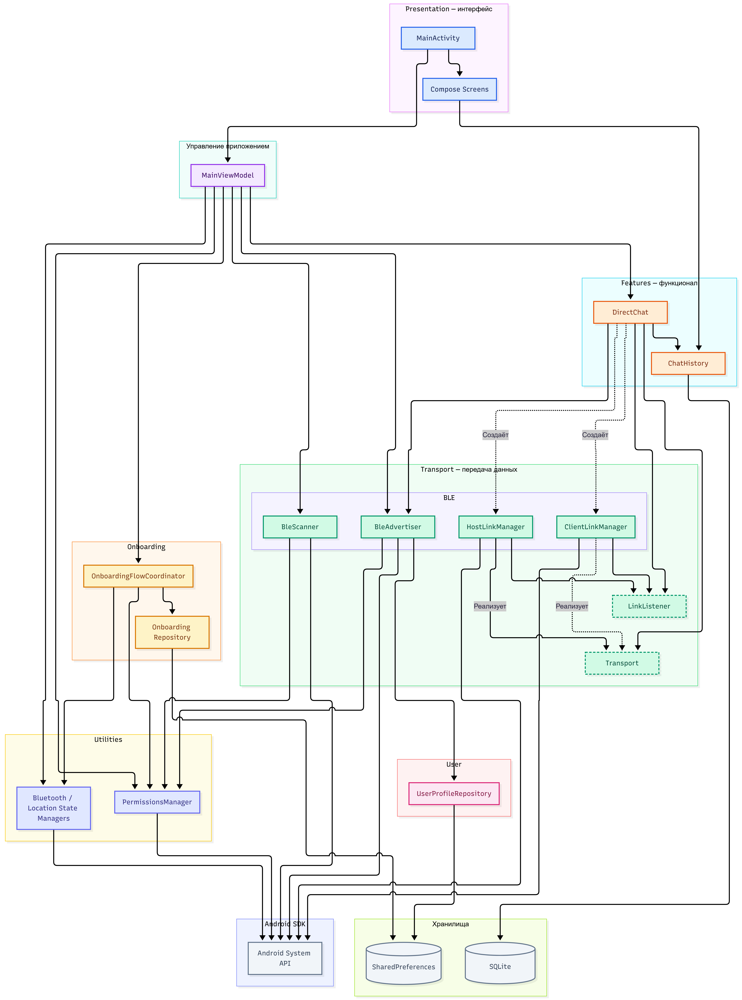
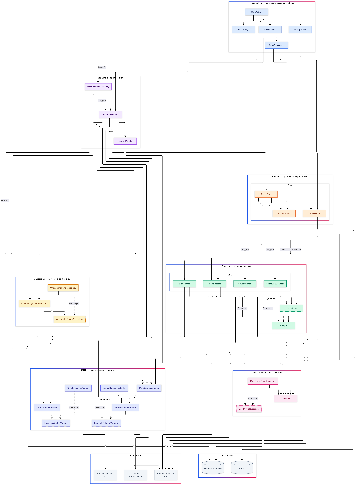

## Phoenix - общие архитектурные особенности.

На данный момент мы используем MVVM в сочетании с многослойной архитектурой (Layered Architecture) 
и отдельными принципами Clean Architecture (некоторые компоненты не соответсвуют главному принципу
Clean Archiutecture - Dependency Inversion rule: внутренняя логика не должна зависеть от конкретной
базы данных, пользовательского интерфейса, способа передачи информации и т.д. Примером такого компонента
является `DirectChat`, который сильно зависит от конкретного транспортного канала). 

При этом MVVM и Clean Architecture не противоречат другдругу, т.к. решают разные задачи и могут 
использоваться одновременно: MVVM используется на уровне представления, Clean Architecture определяет
организацию и зависимости приложения в целом.

### 1. Общая диаграмма архитектуры Phoenix
Ниже представлена диаграмма зависимостей, условные обозначения: 
- сплошная линия - компонент A хранит ссылку на компонент B или использует его функционал;
- пунктирная с подписью "создает" - компонент A создает экземпляр B;
- пунктирная с подписью "реализует" - компонент A реализует интерфейс B.

Более детальная диаграмма:

