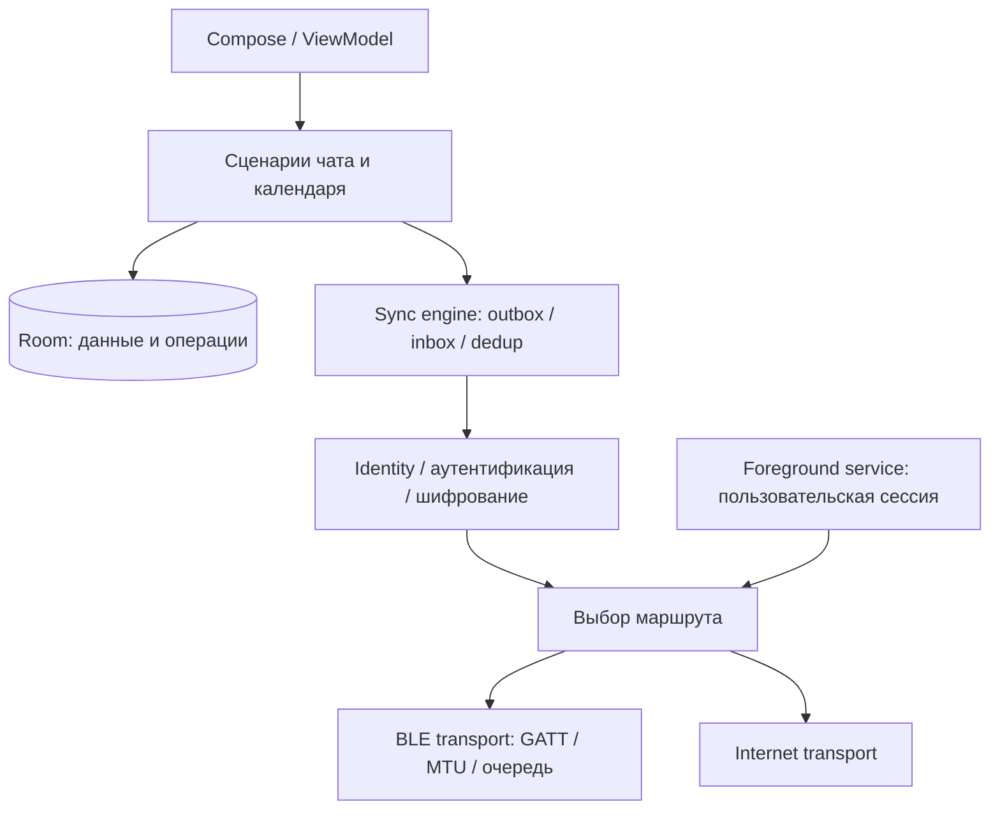

# Архитектурный аудит Phoenix

Дата: 5 ноября 2026. Исходная ревизия Phoenix: `9e94f6cb2eb6b28b2217ce55522dd2fda54d2e03`.
Для сравнения использована ревизия Bitchat `998f1684878f1e8aaf2c4d5ad682795acd3cedad`.

## Фактическое состояние

Phoenix — прототип onboarding и BLE discovery, а не готовый mesh-мессенджер.
`MainActivity` создаёт зависимости; `MainViewModel` координирует onboarding,
обрабатывает найденные устройства и формирует UI. `BluetoothGattClientManager`
сканирует эфир. `BluetoothGattServerManager.startAdvertising()` только собирает
`AdvertiseData`, не вызывает Android advertising API и не открывает GATT server.
`BluetoothConnectionManager` пуст. Нажатие на устройство содержит TODO.
В опубликованном коде нет отправки сообщений, HELLO/ACK, фрагментации, relay,
хранилища сообщений, управления ключами и интернет-транспорта.

Хорошая основа: Compose + ViewModel + StateFlow, отдельная машина onboarding,
интерфейсы адаптеров Bluetooth/Location, документированные границы MVP.
`meshMVP/README.md` уже правильно исключает совместимость со стандартом Bluetooth Mesh.
Формулировку «mesh» в продуктовых обещаниях следует привязать к появлению relay.

## Найденные и исправленные ошибки

| Приоритет | Проблема в исходной ревизии | Исправление |
| --- | --- | --- |
| Высокий | Отложенный `startScanning()` продолжал работу после `stopScanning()`, порождал несколько таймеров | Контроллер с одним отменяемым таймером; stop/close меняют поколение сессии, устаревший таймер не запускает радио |
| Высокий | Большинство `onScanFailed()` оставляли `isScanning=true`; UI показывал сканирование при ошибке | Любая ошибка завершает сессию, освобождает scanner/callback и публикует код ошибки через StateFlow |
| Высокий | `bleScanner` лениво кэшировался, включая null при выключенном Bluetooth; nullable start считался успешным | Scanner получается заново при каждом запуске; отсутствие адаптера/scanner и выключенное радио дают явное состояние |
| Высокий | Activity передавалась в объекты, удерживаемые ViewModel; отдельный IO scope никогда не отменялся | Application context, менеджер владеет отменяемым scope, ViewModel закрывает его в onCleared |
| Средний | При потере permissions stop выходил раньше очистки локального состояния | Cleanup не зависит от предварительной проверки permissions; SecurityException перехватывается при реальном вызове stopScan |
| Средний | `System.currentTimeMillis()` использовался для интервала запуска, 5 секунд недостаточно для безопасного соблюдения распространённого ограничения 5 стартов за 30 секунд | Monotonic elapsedRealtime, интервал 6,5 секунды, учитываются и неуспешные попытки; OEM-ограничения всё равно возможны |
| Средний | UI использовал `isBluetoothEnabled=true`, оптимистически объявлял SCANNING до результата старта | Реальный статус адаптера; WAITING, SCANNING и ошибки поступают из контроллера |
| Средний | Android 12+ требовал location несмотря на neverForLocation; повторный onboarding на Android 10–11 пропускал выключенную location | Единая политика по API: location только до API 31; manifest maxSdkVersion=30; проверки location при onboarding и фактическом старте |
| Средний | `ALL_SET` завершал onboarding без повторной проверки обязательных условий | Повторная проверка перед завершением и после возврата из Settings; неподдерживаемый BLE отображается как ошибка |
| Средний | Установленные scanFilters игнорировались, проверка UUID была закомментирована | Фильтр сервисного UUID передаётся Android и повторно проверяется в callback |
| Средний | Поздний callback старой сессии мог обновлять новый scan | Поколение привязано к отдельному ScanCallback каждого запуска |
| Средний | Bluetooth receiver был NOT_EXPORTED, что может исключать broadcasts привилегированного Bluetooth-процесса | EXPORTED для системного Bluetooth action; состояние считывается из адаптера, extras не считаются достоверными; регистрация идемпотентна |
| Низкий | connectable всегда true, отсутствующий TxPower представлен Int.MIN_VALUE; часть metadata не обновлялась | Данные из ScanResult, null для неизвестного TxPower, обновление metadata повторных наблюдений |
| Средний | Одноразовые Activity-события терялись при отсутствии подписчика SharedFlow во время пересоздания Activity | Buffered Channel с receiveAsFlow без повторного проигрывания уже потреблённых команд |

Сканирование текущего прототипа останавливается в Activity.onStop. Это осознанный
режим работы без фонового сервиса. Ротация экрана прекращает сканирование, но
ViewModel и найденный список сохраняются. Автовозобновление не реализовано.

Проверка UUID теперь отбрасывает посторонние BLE-устройства. Два экземпляра
Phoenix пока не смогут найти друг друга: собственный advertiser ещё отсутствует.
Для проверки discovery нужен внешний advertiser с UUID из AppConstants.
Это ограничение исходного MVP, а не реализация обмена сообщениями в этом изменении.

## Сравнение с Bitchat

Актуальный Bitchat уже поддерживает BLE + интернет через Nostr. Само сочетание
офлайн и интернет-транспорта не является отличием Phoenix; совместные структурированные
данные и удобство их синхронизации могут стать таким отличием.

Изучены README и компоненты `BluetoothGattClientManager`, `BluetoothPermissionManager`,
`BluetoothMeshService`, `MeshTransport`, `UnifiedMeshService`, `TransportBridgeService`,
`FragmentManager`. Это выборочное архитектурное сравнение, не аудит безопасности всего Bitchat.

Полезные границы ответственности:

- `BluetoothConnectionManager` и GATT managers: Android API, соединения и очередь операций.
- `FragmentManager`: отдельная фрагментация и ограниченная сборка пакетов.
- `PacketProcessor` и relay: обработка протокола отдельно от UI.
- `MeshTransport`: единый контракт транспорта, результат принятия записи.
- `UnifiedMeshService`: выбор локального транспорта; интернет-маршрутизация также требует своей политики.
- Identity и криптосессии живут выше краткоживущего MAC/соединения.

Не стоит переносить компоненты изолированно без их контрактов. Например,
проверенный BluetoothPermissionManager Bitchat запрашивает location и на новых API:
для Phoenix это расходится с уже заявленной политикой neverForLocation.
У Bitchat есть retry/watchdog и управление питанием; их нельзя безопасно заменить
неограниченными циклическими перезапусками сканера.
Крупный BluetoothMeshService связывает много задач и не должен становиться местом
для календарной бизнес-логики Phoenix.

## Рекомендуемая целевая архитектура

Пока достаточно пакетов внутри одного app-модуля. Gradle-модули стоит выделять,
когда появятся устоявшиеся интерфейсы: `core:model`, `core:protocol`, `core:sync`,
`transport:ble`, `transport:internet`, `feature:chat`, `feature:calendar`.
Domain-модели не должны импортировать Android, GATT или Compose.
Текущий scanner всё ещё отдаёт BleDeviceUiModel: следующий небольшой рефакторинг —
ввести нейтральное DiscoveryObservation и преобразовывать его в UI во ViewModel.

Транспорт принимает байты и destination/link, сообщает об ограничениях размера,
состоянии соединения и результате локальной отправки. Результаты должны различать
«поставлено в очередь», «запись принята Android», «подтверждено удалённой стороной»,
«сохранено получателем» и «прочитано». Успешный GATT write не равен доставке сообщения.
Один и тот же logical operation/message ID используется на BLE и в интернете.

### BLE/GATT до реализации mesh

1. Завершить advertiser и GATT server, затем прямой обмен двух устройств.
   При legacy advertising соблюдать лимит 31 байт. Для 128-bit UUID + service data
   + tx power + произвольного имени места может не хватить. Основной ADV должен
   содержать service UUID, имя можно переносить в scan response. Обрабатывать
   отсутствие поддержки advertiser и `onStartFailure`, ждать `onServiceAdded`.
2. Отдельная последовательная очередь GATT-операций на соединение: discovery,
   MTU negotiation, CCCD subscription, запись. Следующая операция стартует после
   callback или таймаута; отвергнутый синхронно вызов также завершает текущую.
3. Закрывать BluetoothGatt при окончательном disconnect/ошибке; связывать callbacks
   с поколением соединения. Не использовать autoConnect=true как универсальный retry.
4. Размер ATT-полезной нагрузки определяется согласованным MTU, обычно MTU-3 для
   обычной characteristic write/notification, с учётом собственного framing.
   Не считать MTU=517 гарантированным; Android 14 изменил поведение requestMtu.
5. Проверять prepared writes, offset, responseNeeded, UUID и длины на сервере;
   реализовать CCCD и уведомления отдельно от локального setCharacteristicNotification.
6. Добавить ограниченные очереди, deadlines и exponential backoff с jitter;
   relay, TTL, dedup и store-and-forward — после стабильного direct link.
7. LOW_LATENCY пригоден для короткого discovery. Для длительной сессии нужны
   duty cycle и power policy; не держать такой scan бесконечно.

### Жизненный цикл и безопасность

Для непрерывной пользовательской mesh-сессии нужен foreground service с подходящим
типом `connectedDevice`, manifest permissions и соблюдением ограничений запуска
Android 12–16. Service владеет радио, ViewModel только наблюдает состояние.
Сейчас добавление декларации сервиса без реализации создало бы ложное ожидание фоновой работы.
После убийства процесса соединений нет; восстановление — новая сессия.

BLE MAC может меняться и не является peer identity. Нужна долговременная
криптографическая identity, связывание peerId с проверенным ключом, явная модель
доверия и проверенный протокол установления защищённой сессии. UUID и имя в
advertisement не аутентифицируют участника. ACK и календарные изменения также
требуют аутентификации. Не разрабатывать собственный криптопротокол.

До хранения приватной переписки пересмотреть allowBackup/dataExtractionRules и
жизненный цикл ключей. Сейчас в prefs хранится только отметка onboarding;
это не обнаруженная утечка сообщений, которых в проекте ещё нет.
Ограничить размер и время жизни discovery cache, входных пакетов, фрагментов,
число активных сборок, объём outbox и попытки handshake.

## Совместный календарь: отдельная задача синхронизации

Пример: A создаёт событие, B меняет время, A офлайн меняет название. Отправка
полного события с последней timestamp может уничтожить одно из изменений;
часы телефонов не дают надёжного порядка операций.

Хранить операции как минимум с `operationId`, `calendarId`, `eventId`, `actorId`,
версией схемы и причинным контекстом (например, actor counter + version vector).
В Room транзакционно записывать локальное изменение и outbox; входящую операцию
и её dedup ID тоже применять одной транзакцией. Повторная доставка идемпотентна.
Для зависимой операции «изменить событие» до «создать событие» предусмотреть
буферизацию/повторную синхронизацию. Удаление требует tombstone, иначе старый peer
воскресит запись после офлайна.

Для MVP: независимые поля с детерминированным merge, а одновременные изменения
одного времени/повторения показывать как конфликт. Более сложное редактирование
может потребовать CRDT; выбирать его отдельно для набора участников, текста,
повторений и временных интервалов. Wall-clock timestamp не должен единолично
решать победителя. Аутентификация автора и проверка прав выполняются до применения.
Отзыв доступа в офлайн-сети нельзя считать мгновенным.

Перед реализацией определить правила timezone/DST, recurring events, исключений
в серии и семантики удаления. BLE и интернет переносят одни и те же операции,
а sync engine сверяет версии/недостающие операции и ограниченно обменивается
snapshot + последующим журналом. Календарь не должен зависеть от срока жизни
эфемерного чата или криптосессии одного транспорта.

## План следующей разработки

1. Стабильный direct BLE link двух физических устройств: advertiser, GATT,
   bounded operation queue, HELLO/DATA/ACK, reconnect и тесты MTU/таймаутов.
2. Room inbox/outbox, единые IDs и подтверждение после durable storage,
   версионирование wire protocol и защита сессии.
3. Управление длительной сессией в foreground service; испытания power/background.
4. Relay/TTL/dedup и ограниченное store-and-forward; тест A–B–C без прямой связи A–C.
5. Второй transport с теми же IDs и семантикой ACK; тест дубликатов через оба канала.
6. Календарные операции, права, конфликтные изменения и восстановление после офлайна.

## Проверки и границы результата

Регрессионные JVM-тесты проверяют отмену отложенного старта, идемпотентный запуск,
поздние callbacks, синхронную/асинхронную ошибку, смену permissions перед таймером,
закрытие и политику permissions Android 10–16. Это не тесты реального радио.
Результаты сборки и Lint фиксируются в описании PR и итоговом ответе.

Минимальная аппаратная матрица: Android 10/11 и 12+, желательно разные OEM.
Проверить отключение Bluetooth, отзыв permissions, location off на API 29/30,
быстрые start/stop, поворот, уход в фон, возвращение из Settings и scanner failure.
С внешним advertiser проверить совпадающий/чужой UUID, изменяемые metadata,
connectable=false и отсутствие TxPower. neverForLocation может фильтровать
некоторые типы BLE advertisements — выбранный формат нужно проверить на устройствах.

Подтверждение исправления GATT, доставки, шифрования и календаря невозможно:
эти подсистемы ещё не реализованы. Полный аудит безопасности и нагрузочные
испытания всей будущей mesh-сети в эту проверку не входят.
